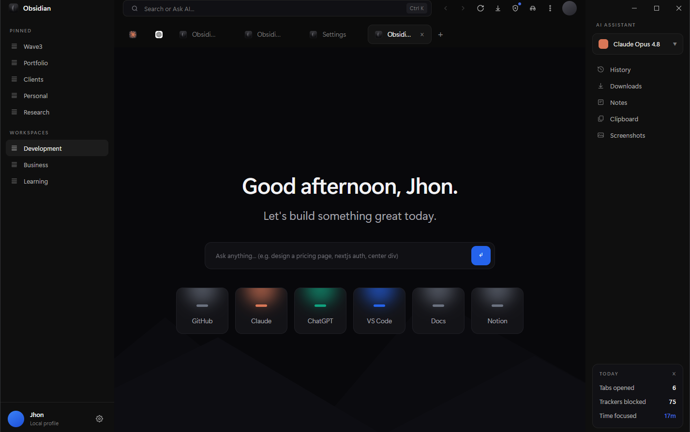
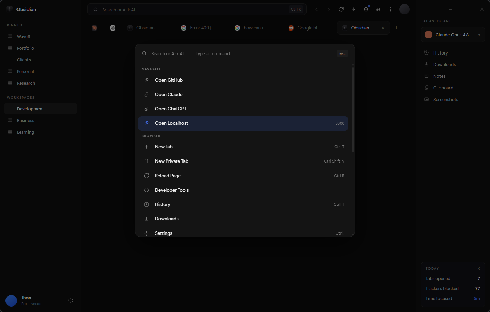
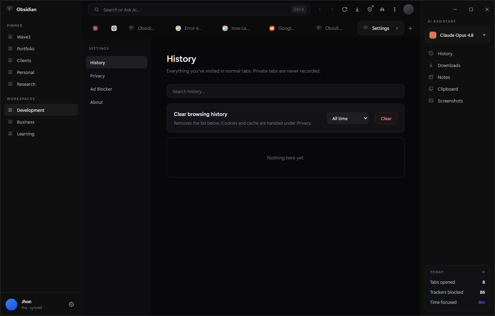
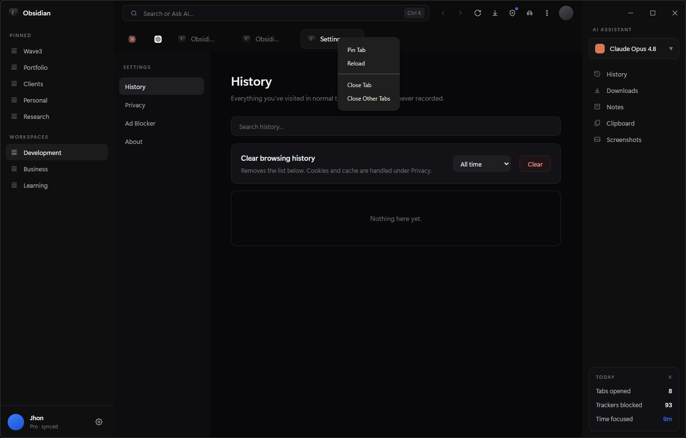
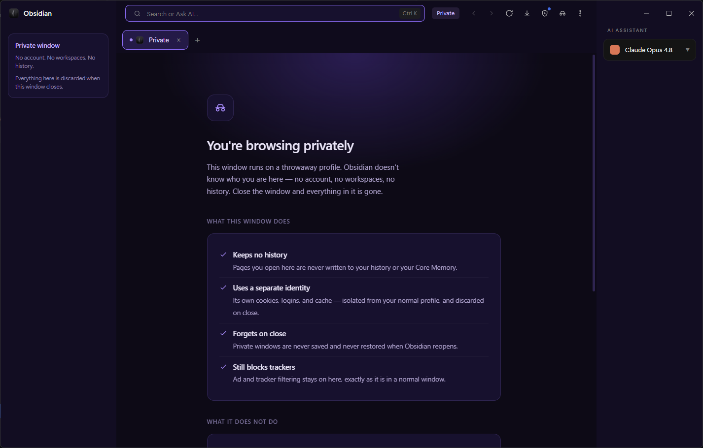
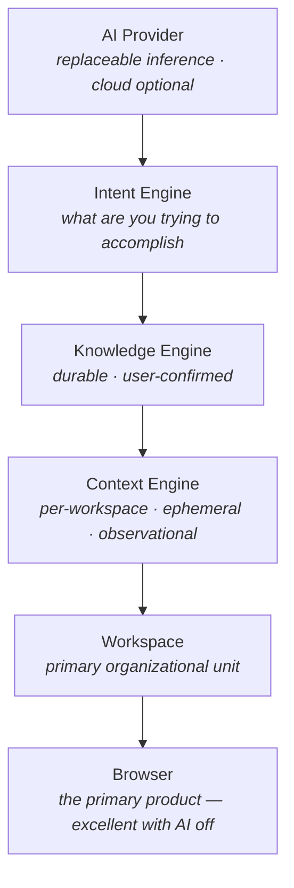
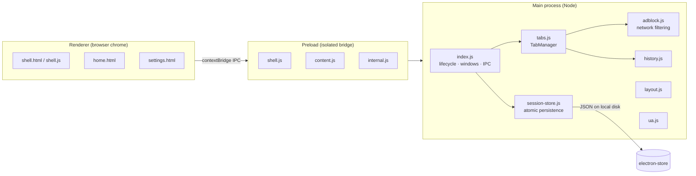
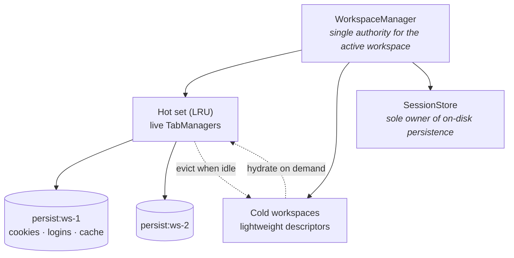

<h1 align="center">Obsidian Browser</h1>

<p align="center">
  <strong>A workspace-first browser for people who build.</strong><br/>
  Chromium-based. Keyboard-first. Local-first. Designed to accumulate engineering knowledge over time.
</p>

<p align="center">
  
  
  
  
  
  
</p>

<p align="center">
  
</p>

---

## Overview

Obsidian is **not a Chrome clone, and deliberately not an AI browser.**

Chrome is a browser for reading the web. Obsidian is a browser for *building things* — one that
keeps your projects, tools, and context in a single quiet environment, remembers exactly where you
left off, and grows into a system that understands what you're working on.

The long-term goal is a **Personal Intelligence System**: an environment that gets smarter by
accumulating knowledge and context, not by retraining a model. The model stays static and stateless;
intelligence lives in what the browser has stored and can retrieve.

> **Status:** early development · Windows · single-user · not yet packaged for distribution.
> Milestone 1 (Foundation) is complete and the browser is stable enough for daily use.

---

## Problem

Browsers optimize for consumption. For people who build, that's the wrong target:

- **Context is scattered.** Tabs are a flat, undifferentiated pile. A project isn't a first-class thing.
- **Context is lost.** Restart the browser and the working set is gone. Every session starts from zero.
- **Context is never understood.** The browser sees every page you read and learns nothing from any of it.
- **AI is bolted on.** Existing "AI browsers" put a chat window on top of a browser and call it intelligence — which slows the browser down and still doesn't know what you're doing.

## Constraints

The design was shaped by hard limits, stated up front:

| Constraint | Consequence |
|---|---|
| Solo developer, no team | Milestone-at-a-time delivery; the browser must be stable and usable after every milestone |
| Must be my daily driver | Regressions are unacceptable — browser quality gates every AI feature |
| Privacy is non-negotiable | Local-first storage; cloud is optional and never required |
| Memory budget is finite | Inactive workspaces must evict, not accumulate |
| No vendor lock-in | The AI provider must be replaceable, never load-bearing |

---

## Screenshots


**Home** — pinned projects and workspaces in the sidebar, assistant panel on the right, quick-launch
targets below the prompt.


**Command palette (`Ctrl+K`)** — commands grouped by intent (Navigate, Browser) with shortcut hints
inline. Custom navigation targets, including a dev-server entry, sit alongside built-in browser
actions. Every action in the browser is reachable here; there are no menus to hunt through.


**Settings (`Ctrl+,`)** — history, privacy, and ad-blocker statistics, rendered as an internal page
in a normal tab rather than a modal. Private tabs are never recorded, and clearing history is
deliberately separated from clearing cookies and cache — two different intentions, two different
controls.


**Tab strip** — pinned tabs collapse to favicon-only at the left of the strip and survive restart.
The right-click menu is a **native OS menu**, not an HTML popup: Pin Tab, Reload, Close Tab, Close
Other Tabs. Rendering it natively means it can't be intercepted or restyled by page content, and it
behaves exactly like every other Windows context menu.


**Private window (`Ctrl+Shift+N`)** — private browsing opens a *separate window*, not a tab, on a
throwaway in-memory session partition. The chrome carries no identity: account, pinned links,
workspaces, and session stats are removed from the DOM entirely, so the claim "Obsidian doesn't know
who you are here" is literally true of the UI and not just the storage layer. The landing page states
what the mode does, what it explicitly does *not* do, and why it exists — a private mode that
overpromises is a security problem, not a feature.

> **On what these screenshots show.** The workspace list, the assistant rail, and the model selector
> are **designed-ahead UI shells, not working features** — the engines behind them are Milestones
> 2–6 and are not built. They ship in the interface on purpose: designing the surface first is what
> exposed the ownership questions the Workspace Engine had to answer (who owns switching, what
> isolation actually means, where session persistence lives) before a line of it was written. The
> command palette already labels those actions "soon", and the roadmap below tracks what is real.
> Everything else pictured — tabs, pinned tabs, session restore, command palette, settings, ad
> blocking, private windows — is shipped and working.

<!-- OPTIONAL UPGRADE: reshoot settings.png on the "Ad Blocker" tab — the trackers-blocked -->
<!-- stat evidences network-layer filtering better than an empty history state does.       -->
<!-- tabs.png             — tab strip with pinned tabs and the right-click tab menu -->
<!-- private-tab.png      — Ctrl+Shift+N isolated private session -->

---

## Features

Shipped in v0.1.0 (Foundation):

- [x] **Chromium-based tabbed browsing** in a Windows-native frameless window
- [x] **Full session restore** — tabs, pinned tabs, window size/position, and scroll position
- [x] **Command palette** (`Ctrl+K`) — every action reachable, no menu hunting
- [x] **AI-aware address bar** — one input for URLs, web search, or natural-language questions
- [x] **Ad & tracker blocking** — EasyList / EasyPrivacy applied at the network layer
- [x] **Private windows** (`Ctrl+Shift+N`) — a separate window on a throwaway, fully isolated session, with no account, workspaces, or history in its chrome
- [x] **Crash resilience** — dead renderers auto-reload; failed loads show a retry page, never a blank void
- [x] **Settings** — persisted history, privacy / clear-data, ad-blocker statistics
- [ ] **Workspace Engine** — persistent, session-isolated workspaces *(Milestone 2, in progress)*
- [ ] **Context Engine** — per-workspace working context *(Milestone 3)*
- [ ] **Knowledge Engine** — durable, scoped long-term knowledge *(Milestone 4)*
- [ ] **AI actions** — summarize, explain, review, built in *(Milestone 6)*

---

## Tech Stack

| Layer | Choice | Why |
|---|---|---|
| Shell | Electron 38 | Chromium engine + Node main process in one deployable; the only realistic path to a custom browser solo |
| Rendering | Chromium `WebContentsView` | Per-tab process isolation, and the primitive that makes per-workspace session partitions possible |
| Blocking | `@ghostery/adblocker-electron` | Network-layer filtering — faster and harder to bypass than DOM-level blocking, and no extension surface |
| Persistence | `electron-store` | Atomic JSON writes on local disk; no database needed for session state, and local-first by default |
| UI | Vanilla HTML/CSS/JS | Zero build step. The browser chrome must render instantly — a framework would add startup cost to the one surface that can never feel slow |

Three runtime dependencies total.

---

## Architecture

### Layered design (long-term)

Each layer sits *below* the next and never depends upward. AI reads from the lower layers; it is
never foundational. If AI ever slows down browsing, the AI is wrong.



### Process architecture (as built)



### Workspace isolation model (approved, Milestone 2)

Workspaces are not visual tab groups. Each workspace gets its own **Chromium session partition**
(`persist:ws-<id>`) — separate cookies, logins, cache, and history. Switching workspaces switches
identity, not just layout.



Full design rationale: [ARCHITECTURE.md](ARCHITECTURE.md) · [VISION.md](VISION.md) · [Decision records](docs/adr/)

The table below summarizes the decisions. The reasoning — including the alternatives that were
rejected and why — lives in [`docs/adr/`](docs/adr/), which is append-only so it cannot drift as the
code changes.

---

## Engineering Decisions

| Chosen | Over | Why |
|---|---|---|
| AI as the **topmost** layer | AI as a foundational feature | The browser must be excellent with AI switched off. Anything else produces a slow browser with a chat window. |
| **Session partitions** per workspace | Visual tab grouping | Real isolation — separate logins and cookies. Grouping is cosmetic; partitioning is architectural. |
| **Confirmed actions** grow Knowledge | Passive observation | The hard line between Context (ephemeral, observed) and Knowledge (durable, confirmed). Passive capture makes a surveillance tool, not a work tool. |
| Knowledge **separate from history** | One unified store | Clearing browsing history must never erase what you've learned. Different lifecycles, different subsystems. |
| **LRU hot set** for workspaces | Keep every workspace live | Memory stays bounded as workspace count grows; switching stays instant for the ones that matter. |
| **Replaceable AI provider** | Integrate one vendor deeply | Model vendors change quarterly. The knowledge substrate must outlive any of them. |
| Private browsing as a **window** | A private tab in the normal window | A tab is a colour; a window is a boundary the OS itself enforces. Mode confusion is the failure case, and separate windows make it structurally hard. |
| **Removing** identity from private chrome | Hiding it with CSS | Hidden-but-present means your name is still in the DOM of a session that claims not to know you. Absence is the only honest implementation. |
| Stating what private mode **can't** do | Listing only the guarantees | Users overestimate private browsing. An explainer that omits the limits trains a false sense of safety — the omission is the vulnerability. |
| Per-window **context map** | `win`/`tabs` singletons | Windows are the unit the Workspace Engine will multiply. Routing IPC by sender now avoids a rewrite at Milestone 2. |
| **Vanilla JS** for browser chrome | React / Svelte shell | The chrome is the one surface that can never feel slow. Zero build, zero hydration, instant paint. |
| **Milestone gating** | Building the vision in parallel | Every milestone leaves a browser stable enough to use daily. Nothing half-built ships. |

**Deliberately deferred:** Chrome Sync, an extension ecosystem, cloud accounts, themes, mobile.
These are postponed until the browser itself is exceptional — feature breadth before quality is how
browser projects die.

---

## Folder Structure

```
src/
  main/                 Main process — privileged, owns everything stateful
    index.js            App lifecycle, window creation, IPC surface
    tabs.js             TabManager — WebContentsView lifecycle, crash recovery
    session-store.js    Sole owner of on-disk session persistence (atomic writes)
    adblock.js          EasyList / EasyPrivacy at the network layer
    history.js          Persisted browsing history
    layout.js           Window chrome geometry
    ua.js               User-agent handling
  preload/              Context-isolated bridges — no direct Node in renderers
    shell.js            Browser chrome bridge
    content.js          Web content bridge
    internal.js         Internal pages bridge
  renderer/             Browser chrome UI — zero build step
    shell.html/.js/.css Tab strip, address bar, sidebar, command palette
    home.html           New-tab / home surface
    settings.html       History, privacy, ad-blocker stats

assets/                 Icons and branding
tools/                  Build utilities (icon generation)
docs/screenshots/       README imagery
```

**Why this shape:** privilege boundaries are directory boundaries. `main/` can touch the filesystem
and the network; `renderer/` cannot; `preload/` is the only bridge, and it exposes a named API
surface rather than raw Node. That's the same isolation model Chromium itself uses, and it's the
reason a compromised page can't reach the session store.

---

## Getting Started

Requires Node.js 18+ and Windows.

```bash
git clone https://github.com/jhon-hub-work/ObsidianBrowser.git
cd ObsidianBrowser
npm install
npm run dev
```

### Scripts

| Command | Purpose |
|---|---|
| `npm run dev` | Launch the browser in development |
| `npm run icon` | Regenerate application icons from source SVG |
| `npm run build` | Build a Windows NSIS installer via electron-builder |

### Keyboard shortcuts

| Shortcut | Action |
|---|---|
| `Ctrl+K` | Command palette |
| `Ctrl+T` | New tab |
| `Ctrl+Shift+N` | New private tab |
| `Ctrl+R` | Reload page |
| `Ctrl+H` | History |
| `Ctrl+,` | Settings |

No environment variables are required — Obsidian is local-first and runs entirely offline apart
from the pages you visit.

---

## Roadmap

| # | Milestone | Status |
|---|---|---|
| 1 | **Foundation** — stability, session restore, crash resilience | ✅ Complete (v0.1.0) |
| 2 | **Workspace Engine** — persistent, session-isolated workspaces | In progress |
| 3 | **Context Engine** — per-workspace awareness of current work | Planned |
| 4 | **Knowledge Engine** — durable, scoped long-term knowledge | Planned |
| 5 | **Intent Engine** — understands what you're trying to accomplish | Planned |
| 6 | **AI Actions** — summarize, explain, review, built in | Planned |

Longer-term: full daily-driver parity, and Google OAuth solved with supported approaches rather than
embedded-browser workarounds. Detail in [ROADMAP.md](ROADMAP.md) · history in [CHANGELOG.md](CHANGELOG.md).

---

## Lessons Learned

- **Deciding what *not* to build was the hardest engineering work.** Writing ARCHITECTURE.md as a set of binding decisions — before implementation — killed more bad features than any code review would have.
- **"AI browser" is an architecture trap.** Once AI is foundational, every performance problem becomes unfixable. Putting it at the top of the stack cost nothing up front and preserved every option.
- **Isolation must be architectural, not visual.** The first instinct was tab groups. Session partitions are strictly more work and strictly more correct — grouping would have had to be ripped out later.
- **Crash resilience is a feature, not a chore.** Auto-recovering dead renderers and a retry page instead of a blank void changed the browser from "demo" to "daily driver" more than any feature did.
- **A correct privacy feature that doesn't *look* different isn't a privacy feature.** Private tabs were fully correct underneath — isolated partition, excluded from history, never persisted — but styled with a 1px dashed border in a colour that vanished against the dark theme. The security property was real and the affordance was missing, which is the worst combination: the user can't tell which mode they're typing into. Correctness and legibility turned out to be the same requirement.
- **The fix for that wasn't more styling — it was a different container.** Tinting the tab harder would have kept treating a mode boundary as a visual problem. Promoting private browsing to its own window let the operating system enforce the separation, and the personalized home page and signed-in sidebar stopped being edge cases to suppress because they were simply never in that window.
- **Multi-window was cheap because the boundary was already right.** `TabManager` had taken its window as a constructor argument from day one, so supporting N windows meant replacing two globals with a lookup map — not a rewrite. The architectural decision that "the app layer owns windows" paid for itself well before the Workspace Engine it was written for.
- **Milestone gating beats parallel ambition.** Six engines designed at once would have shipped none. One at a time, each leaving a usable browser, is the only solo-viable path.

---

## Future Improvements

- Package and sign a distributable Windows build; add auto-update
- Cross-platform support (macOS, Linux) once the Workspace Engine settles
- Automated tests around session restore and tab lifecycle — currently the highest-risk untested path
- Telemetry-free performance instrumentation (startup time, memory per workspace) to enforce the performance principles with numbers rather than intent
- Local embedding + retrieval for the Knowledge Engine, kept fully on-device

---

## License

Personal project — all rights reserved for now. See [`LICENSE`](LICENSE) once distribution begins.

---

<p align="center">
  <sub>Designed, built, and documented by <strong>Jhon Buerano</strong>.</sub><br/>
  <sub><a href="https://jhonmbuerano.netlify.app">Portfolio</a> · <a href="https://www.linkedin.com/in/jhon-mycho-buerano">LinkedIn</a></sub>
</p>
